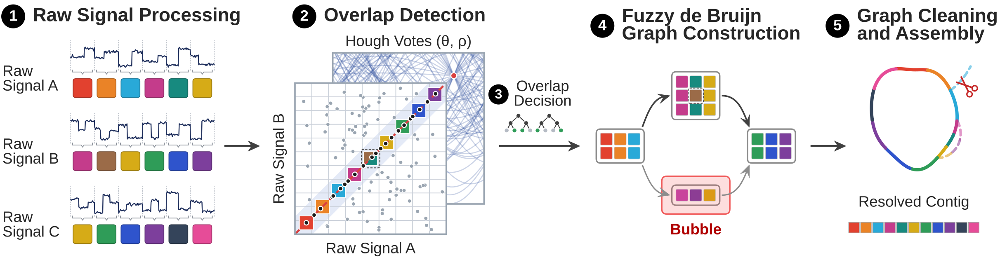

[](LICENSE)
[](rust-toolchain.toml)
[](https://doi.org/10.5281/zenodo.23963126)

# HARICOT: genome assembly from raw nanopore signals

HARICOT assembles genomes directly from raw nanopore signals, without basecalling. It builds a fuzzy de Bruijn graph, as
[wtdbg2](https://github.com/ruanjue/wtdbg2) does for nucleotide sequences, over *e-mers*: short runs of signal events
from the signal processing of [RawHash2](https://github.com/CMU-SAFARI/RawHash) (ONT R10.4.1). The output is a layout:
unitigs as paths of read segments, with no consensus sequence.

## Abstract

Nanopore sequencing enables reading long nucleotide sequences by measuring characteristic changes in ionic current as
molecules pass through a nanopore. These current measurements, known as raw signals, can be analyzed without
translating them into bases (i.e., without basecalling), which provides fast and resource-efficient genome analysis.
Prior work, Rawsamble, enables finding overlaps between raw nanopore signals, *without* basecalling them, and
generating assemblies from these overlaps with off-the-shelf assemblers such as miniasm. Constructing assemblies
directly from raw signals can substantially reduce redundancy and fragmentation in signal datasets, which is useful for
many downstream tasks such as constructing non-redundant and accurate basecalled reads from assembled signals.
However, existing overlap-based signal assembly strategies suffer from limited scalability and resolution mainly due to
using off-the-shelf assemblers (e.g., miniasm) that are designed for basecalled sequences. While scalability and
performance limitations can be addressed by existing de Bruijn graph approaches to assembly, their reliance on exact
matches makes these methods too sensitive to the inherently noisy raw nanopore signals.

To improve assembly of raw signals using de Bruijn graph approaches, we present HARICOT, a mechanism that constructs
assemblies from raw nanopore signals by utilizing fuzzy de Bruijn graphs and Hough-transform-based overlap detection to
robustly tolerate errors and noise in raw nanopore signals. Our evaluations on various genomes of different sizes show
that HARICOT significantly improves assembly contiguity and quality compared to Rawsamble, helping close the gap to
popular assembly tools such as Flye or wtdbg2 operating on nucleotide sequences. At the same time, performance remains
comparable to these assemblers, without requiring additional basecalling. We discuss that assembling raw nanopore
signals before basecalling enables future work in various ways such as building these de Bruijn graphs in a streaming
way and assembly-aware basecalling techniques that can basecall assembly graphs for accurate and redundancy-resolved
basecalling.

This repository holds HARICOT and the scripts that reproduce the manuscript's results
([`docs/REPRODUCE.md`](docs/REPRODUCE.md)).

**At a glance**

- **Input:** one POD5 file of ONT R10.4.1 reads (5 or 4 kHz). **Output:** the assembly layout as GFA, with no
  consensus sequence.
- **One command:** `haricot assemble reads.pod5 -o out` runs the manuscript's configuration.
- **Method:** RawHash2's signal processing; overlap detection by a Hough transform over shared e-mer seeds; three
  random forests that decide which overlaps to keep; wtdbg2's fuzzy de Bruijn graph, graph cleaning and layout.
- **Evaluation:** 56 test sets from 14 datasets (5 bacteria, *A. thaliana*, *D. melanogaster*, human HG002), against
  Rawsamble on the raw signal and against Flye and wtdbg2 on the basecalled reads.
- **Data:** the trained forests and the read lists of every set are on
  [Zenodo](https://doi.org/10.5281/zenodo.23963126). The raw reads come from their public archives (`datasets/`).



**(1)** Each read's raw signal is segmented into events and quantized into e-mers. **(2)** Candidate overlaps between
reads are found from shared e-mer seeds by a Hough transform. **(3)** Random forests decide which candidates are true
overlaps. **(4)** The kept overlaps build a fuzzy de Bruijn graph. **(5)** The graph is cleaned, for example by popping
bubbles, and laid out into contigs.

---

## Installation

HARICOT runs on Linux (the tested platform) and needs a C compiler and [rustup](https://rustup.rs).
`rust-toolchain.toml` pins Rust 1.96.0, which rustup installs on the first build. Reading POD5 needs no system library.

```bash
git clone https://github.com/STORMgroup/HARICOT.git
cd HARICOT
cargo build --release --locked
```

The build writes `haricot` and the programs it runs (`haricot-detect`, `haricot-forest`, ...) into
`target/release/`. Keep them in one directory: `haricot assemble` runs the programs next to its own executable.

Then download the three trained forests (`stage1`, `stage2`, `rescue`) from the Zenodo record
[10.5281/zenodo.23963126](https://doi.org/10.5281/zenodo.23963126) and unpack them in the checkout:

```bash
curl -L -o haricot-forests-v1.tar.gz \
  'https://zenodo.org/records/23963126/files/haricot-forests-v1.tar.gz?download=1'
echo '2b0c37d21d621539480cf29121184278f70f99308efb206edf1c3bca19e9d4f0  haricot-forests-v1.tar.gz' | sha256sum -c
tar -xzf haricot-forests-v1.tar.gz        # -> models/
```

`haricot assemble` reads the forests from `models/` in the checkout (`--models DIR` reads another directory). It
checks each file against the published SHA-256: the first line it prints says `forests=published`, or
`forests=CUSTOM` when a file differs. The forests were trained on five bacteria sequenced at 5 kHz
([`docs/REPRODUCE.md`](docs/REPRODUCE.md#7-retraining-the-forests)).

## Usage

```bash
target/release/haricot assemble reads.pod5 -o asm -t 16
```

**Input.** One POD5 file of ONT R10.4.1 reads sampled at 5 or 4 kHz. The manuscript's test sets hold reads of at least
5 kb, at 6x to 30x per strand. The `pod5` tool (`pip install pod5`) makes one POD5 file from fast5 files or from
several POD5 files:

```bash
pod5 convert fast5 run/*.fast5 --output reads.pod5     # from fast5 files
pod5 merge run/*.pod5 --output reads.pod5              # from several POD5 files
```

**Strands.** HARICOT does not reverse-complement signals, so reads from opposite strands of a region do not overlap. A
set with reads of both strands assembles each strand separately.

**Parameters.** None to tune: the [options](#haricot-assemble-options) set only the threads, the paths and the files
kept. The output does not depend on the order of the reads in the file or on their names (`checks/invariance.sh`).

**Resources.** Forward-strand test sets of the manuscript (up to 30x), with 16 threads:

| set | genome | wall time | peak memory |
|---|---|---:|---:|
| `cj_fwd` | *C. jejuni*, 1.8 Mb | 1.3 min | 2.9 GiB |
| `se_fwd` | *S. enterica*, 4.8 Mb | 3.3 min | 4.7 GiB |
| `at2_fwd` | *A. thaliana* chr. 2, 19.7 Mb | 15 min | 10.4 GiB |
| `hg18_fwd` | human HG002 chr. 18, 78.9 Mb | 63 min | 23.8 GiB |

**Output.** The layout, in signal events: unitigs and contigs as paths of read segments ([Outputs](#outputs)). Bandage
displays `unitigs.gfa`. The layout carries no sequence. For evaluation, `evaluation/anchor_seq.py` writes each unitig
as the basecalled bases of its anchor reads. It needs the reads' basecalls with move tables (`dorado basecaller
--emit-moves`) and the event-to-base map of `truth/truth.sh`, which also needs a reference.

### Example on public data

This example assembles *H. pylori* 26695 at 6x (856 reads, set `hp2_fwd_c6`) from one 1.9 GB POD5 file of the ONT
methylation benchmark. It is one of the manuscript's training sets. The data scripts need Python 3 with the `pod5`
package, which the first command installs.

```bash
conda env create -f envs/haricot.yml && conda activate haricot
curl -L -o haricot-read-lists-v1.tar.gz \
  'https://zenodo.org/records/23963126/files/haricot-read-lists-v1.tar.gz?download=1'
echo '4c64266e21382a1a47d4e0c75a47b1d27c47b26ec3100a51fc9dd0b8f3b9bd92  haricot-read-lists-v1.tar.gz' | sha256sum -c
tar -xzf haricot-read-lists-v1.tar.gz                                  # -> read_lists/
python3 datasets/download.py downloads --set read_lists/training/hp2_fwd_c6    # 1 file, 1.9 GB
python3 datasets/build_set.py read_lists/training/hp2_fwd_c6 downloads -o hp2_fwd_c6.pod5
target/release/haricot assemble hp2_fwd_c6.pod5 -o hp2_asm -t 8
```

`build_set.py` checks every read's signal against the read list. The assembly takes about 10 s on 8 threads (1.1 GB
peak memory) and writes 7 unitigs in 5 contigs into `hp2_asm/`. The held-out test sets are in
`read_lists/final_test/`; [`docs/REPRODUCE.md`](docs/REPRODUCE.md#4-one-test-set-end-to-end) runs the smallest of
them, from download to QUAST scores.

## Pipeline

`haricot assemble` runs these steps. `OUT/time.tsv` records each step's wall time, peak memory and CPU time.

| step | program | figure panel | what it does |
|---|---|---|---|
| `detect` | `haricot-detect` | 1, 2 | segments each read into events, sketches the events into e-mer seeds, finds candidate overlaps by the Hough transform |
| `pair_features`, `stage1` | `haricot-pair-features`, `haricot-forest` | 3 | the features of each candidate pair; the stage-1 forest scores every candidate |
| `graph_features`, `stage2` | `haricot-graph-features`, `haricot-forest` | 3 | how each accepted overlap agrees with the other accepted overlaps; the stage-2 forest scores them |
| `layout` | `haricot-layout` | 4, 5 | keeps the overlaps above a cut set by the depth of the accepted set, builds the fuzzy de Bruijn graph, cleans it and lays out the unitigs; adds bridges between contig ends |
| `rescue`, `rescue_features`, `rescue_forest` | `haricot-rescue`, `haricot-pair-features`, `haricot-forest` | 2, 3 | contig-end rescue: overlaps between contig-end reads that the detection missed, scored by the rescue forest |
| `final` | `haricot-layout` | 4, 5 | adds the rescued overlaps and builds the final graph and layout into `OUT` |

## Outputs

| file | contents |
|---|---|
| `unitigs.gfa` | the layout: one segment per unitig and the links between unitigs; lengths in events |
| `unitig_paths.tsv` | each unitig as a path of nodes; per step: the node's anchor read, its event range on that read, the direction, the events the step advances |
| `unitig_nodes.tsv` | per unitig: anchor read and event range of its first node, coverage, node count, length |
| `contigs.gfa`, `contig_paths.tsv`, `contig_nodes.tsv` | unitigs chained into contigs by mutual-best extension; `contig_paths.tsv` does not record each unitig's orientation |
| `fbg.gfa`, `fbg_nodes.tsv` | the cleaned fuzzy de Bruijn graph; each node's anchor read and event range |
| `threads.tsv` | the graph build's record: each candidate node (`C` rows) and each read's placements on nodes (`T` rows) |
| `read_names.tsv`, `read_content.tsv` | read number to read id; each read's signal content hash |
| `time.tsv` | per step: wall time (s), peak RSS (KB), user and system time (s), exit code |
| `work/` | step logs, forest scores, drop lists and the rescue's tables; with `--keep-work` also the candidate caches, feature tables and intermediate graph builds |

Event ranges count a read's retained events: a run of consecutive events that quantize alike counts once
(`emer::retained_quantized`). Read numbers index `read_names.tsv`.

## `haricot assemble` options

| option | meaning |
|---|---|
| `READS` | input reads (`.pod5`) |
| `-o, --out DIR` | output directory; it must not exist, or be empty, or hold an earlier run (replaced with `--force`) |
| `-t, --threads N` | threads per step (default: all available cores) |
| `-m, --models DIR` | the forests (default: `models/` in the checkout the binary was built from) |
| `--keep-work` | keep the intermediate files in `OUT/work` |
| `--force` | replace `OUT` if it holds an earlier run |

### Other subcommands

| subcommand | what it does |
|---|---|
| `haricot baseline READS` | a plain wtdbg2 / RawHash2 baseline (bin-DP overlaps, fuzzy de Bruijn graph, cleaning) as one GFA; not HARICOT's pipeline |
| `haricot events READS` | segment each read into events; print per-read counts |
| `haricot sketch READS` | sketch each read into e-mer seeds; print per-read counts (`--dump`: every seed) |
| `haricot overlap READS` | print the candidate overlaps (bin-DP, or the Hough overlapper with `--hough`) |
| `haricot info` | print the parameter set |

These subcommands take parameter overrides on top of the R10.4.1 preset (`src/params.rs`); `haricot <subcommand>
--help` lists them.

## Reproducing the manuscript

[`docs/REPRODUCE.md`](docs/REPRODUCE.md) gives the commands for every step:

1. Install Rawsamble (RawHash2), Flye, wtdbg2, QUAST and dorado at the manuscript's versions, and download the
   forests and read lists from Zenodo.
2. Download the raw reads from their public archives and rebuild each read set, checking every read's signal
   (`datasets/`).
3. Basecall the sets and map their signal events to the reference (`truth/`).
4. Assemble each set with HARICOT, Rawsamble, Flye and wtdbg2 (`haricot assemble`, `evaluation/run_tools.sh`).
5. Score the assemblies with QUAST, then build the results table and the appendix figure (`evaluation/`).
6. Optionally, retrain the forests (`training/`) and run the checks (`checks/`).

Section 4 of the guide runs steps 1-5 on one bacterial test set, with a 10 GB download.

## Repository layout

| path | contents |
|---|---|
| `src/` | the library and the `haricot` CLI: signal, e-mers, overlaps, fuzzy de Bruijn graph, layout |
| `pipeline/` | the programs `haricot assemble` runs, `haricot-ovl-filter` (used by the checks), the truth programs |
| `datasets/` | data download and set reconstruction |
| `truth/` | signal-exact truth of a read set (training labels, evaluation) |
| `training/` | forest training |
| `evaluation/` | the other assemblers, scoring, tables, the Bandage figure |
| `checks/` | read-order and read-name invariance; byte identity of two runs |
| `envs/` | conda environments |
| `tests/` | Rust tests; `tests/eval/`: tests of the evaluation scripts |
| `docs/` | `REPRODUCE.md`; the overview figure |
| `vendor/arrow-ipc` | the Arrow IPC reader with a patch for delta dictionaries (`vendor/README.md`) |

## Testing

```bash
cargo test --release --locked                  # Rust: library, CLI and pipeline programs
python -m unittest discover -s tests/eval      # evaluation scripts (envs/haricot.yml)
```

The four end-to-end tests need a fixture that is not distributed and report as ignored without it
(`tests/fixtures/README.md` says how to make it).

## License

MIT ([`LICENSE`](LICENSE)). The raw reads stay under the licences of their sources (`datasets/sources.tsv`).

## Citation

Cite the Zenodo record [10.5281/zenodo.23963126](https://doi.org/10.5281/zenodo.23963126). The manuscript reference
will be added here.

Questions and bug reports: [GitHub issues](https://github.com/STORMgroup/HARICOT/issues).
